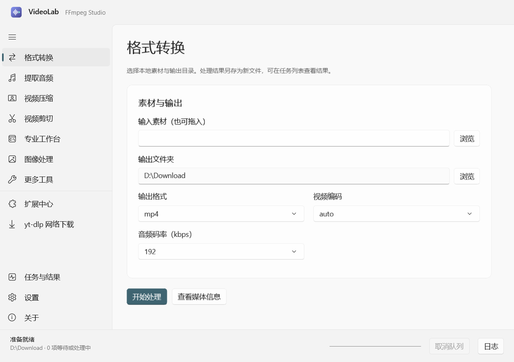

# VideoLab

基于 **WinUI 3 + Fluent Design** 的原生 Windows 音视频工作台。使用 C# / XAML 与 C++ 媒体核心，工程与构建不依赖 Flutter 或 Dart。



## 功能

- 视频/音频格式转换、音轨提取、压缩、剪切。
- 专业视频与音频向导、命令编辑、导入导出、硬件编码检测及预设。
- 批量图像裁剪、缩放、旋转、PNG/JPEG/WebP/BMP/TIFF，视频封面与截图，即时预览及失败重试。
- 静音、镜像、水印、字幕导出、降噪、音量及响度统一。
- 签名 VDX 扩展中心、配置与依赖检测、安装、更新、回滚、卸载，以及 C# 实现的 yt-dlp 下载引擎。
- 任务队列、取消、结果入口、日志、系统/浅色/深色主题，以及旧版设置与 Cookie 导入。

TikTokDownloader 扩展已移除。yt-dlp 仍可按其支持的站点下载媒体。

## 开始使用

目标平台为 Windows 10 2004+ / Windows 11 x64。本机已验证 Windows 11；干净 Windows 10 环境实测尚待补充。

下载构建产物请查看 [GitHub Actions](https://github.com/Cydiacoft/VideoLab/actions/workflows/build.yml)。完整解压后运行 `VideoLab.exe`。发布目录包含 .NET、Windows App SDK、媒体核心及签名下载引擎；FFmpeg、ffprobe、yt-dlp 和可选 Aria2 需在设置中配置。

1. 打开 **设置 → 工具与依赖**，配置 FFmpeg 和 yt-dlp。FFprobe 应与 FFmpeg 位于同一目录；必需工具留空时从 PATH 查找。
2. 点击 **保存并检测依赖**。检测失败时展开“查看检测详情”，按实际路径、版本和失败原因处理；yt-dlp 可通过“安装 / 更新 yt-dlp”自动安装。
3. 在 **设置 → 常规** 中选择默认保存位置，点击“保存设置”。
4. 选择媒体处理功能，或打开 **yt-dlp 网络下载** 粘贴链接并加入下载队列。进度、输出文件和失败原因可在 **任务与结果** 中查看。

### 工具与依赖检测

设置中的“保存并检测依赖”会检查 FFmpeg、同目录的 ffprobe、yt-dlp 和可选 Aria2，并显示实际执行路径、版本与失败原因。工具支持可执行文件路径、工具目录或含 `bin` 的解压目录；必需工具留空时从 PATH 查找，启用 Aria2 后也必须检测通过。FFmpeg 正式版本最低为 4.1.0；Git、每日构建与开发版本保留原版本标识，通过编码器能力检查后可用。应用启动时重新验证媒体引擎，未通过验证时执行按钮不可用，实时预览等待验证；更换路径会使旧检测结果失效，任务启动前也会重新检测工具。

官方 yt-dlp 扩展统一使用设置页的工具路径，扩展中心与下载页的“工具配置”均可进入该页面；第三方扩展保留独立依赖配置。侧栏显示简短的媒体引擎版本与状态，完整信息可通过提示或检测详情查看。

### 网站登录与 Cookies

在下载页的 **网站登录 → 设置** 中选择登录方式：

- **不使用登录信息**：适用于无需账号的公开内容。
- **读取浏览器登录**：先在浏览器中登录目标网站，再选择对应浏览器并保存设置。一般无需填写其他配置；多配置用户可展开“选择其他浏览器配置”，Firefox 还可指定容器。读取失败时可先完全退出浏览器重试，或改用文件导入。
- **导入 Cookie 文件或内容**：选择或拖入 `cookies.txt` / JSON 文件，应用会识别网站、检查有效内容并保存；也可选择“粘贴复制的 Cookie 内容”，填写网站地址后点击“导入并使用”。成功后自动返回下载页。无法确定网站时会提示补填地址。

手动导入支持 Netscape cookies.txt、Cookie 请求头、Cookie-Editor / EditThisCookie JSON。已保存的登录信息可在弹窗中查看和删除，后续下载按域名及常见短链接自动匹配，无需每次重新导入；每个任务使用临时副本，结束后清理。取消配置会恢复之前的选择。浏览器配置参数参见 [yt-dlp 文档](https://github.com/yt-dlp/yt-dlp#filesystem-options)。

Cookie 格式有效不代表网站登录仍然有效。提示过期或登录失效时，请在浏览器中重新登录并导出。Cookie 保存在本机数据目录，应按账号登录信息保管。

### 页面与操作布局

- **网络下载**：链接、下载内容、画质、保存位置和加入队列操作集中展示；宽屏左右排布，窄屏上下排列。链接自动去重，入队后清空输入，方便继续添加任务。
- **高级下载参数**：默认收起，展开后按“格式输出、字幕附件、网络、播放列表、自定义”切换。可选参数显示默认值提示，布尔选项使用勾选框，修改在加入下一批任务时保存并使用。
- **专业工作台**：参数配置与命令编辑分开显示，编码、音频与滤镜参数按类别查看。图像和其他工具只显示当前操作所需的选项，隐藏选项不占空行。
- **设置与扩展**：设置按常规、工具与依赖、硬件加速、数据管理分类；扩展中心区分已安装与发现扩展，版本管理及诊断详情按需展开。
- **任务与结果**：显示实时状态，选中任务查看详情；多个输出文件通过下拉框选择，可打开文件、所在目录或复制路径。实时日志按需展开，窄窗口中的操作按钮自动换行。

## 开发与构建

开发需要 .NET SDK 10.0.200、Visual Studio C++ 桌面工具和 Windows SDK。Windows App SDK 2.5.1 通过 NuGet 还原。

```powershell
./tools/build_winui.ps1 -Task Build
$env:FFMPEG_TEST_PATH = 'D:\ffmpeg\bin\ffmpeg.exe'
./tools/build_winui.ps1 -Task Test -SkipBundle
./tools/build_winui.ps1 -Task Smoke -SkipBundle
./tools/build_winui.ps1 -Task Package -SkipBundle
```

便携目录位于 `build/winui-publish/`，ZIP 和 SHA-256 位于 `dist/`。正式构建传入独立的 `VIDEOLAB_PLUGIN_SIGNING_KEY`，并使用 `-Official`；私钥不进入仓库。

## 工程与数据

`src` 包含原生界面、应用服务、C ABI 桥接、C# 下载引擎和签名打包工具；`native/videolab_core` 包含 C++ 核心；`tests` 包含媒体、插件和数据兼容回归。

数据保存在 `%LOCALAPPDATA%\VideoLab\WinUI3`。旧版数据导入保留来源文件；只迁移设置和 Cookie，不复制旧下载引擎。旧数据路径及 VDX 协议标识仅作为兼容接口保留。

项目由 Videoder 的 Windows 原生迁移分离而来，原 Flutter 项目保留在 [Cydiacoft/Videoder](https://github.com/Cydiacoft/Videoder)。许可为 GPL-3.0-only，原始代码的版权与许可声明见 LICENSE 和 NOTICE。
